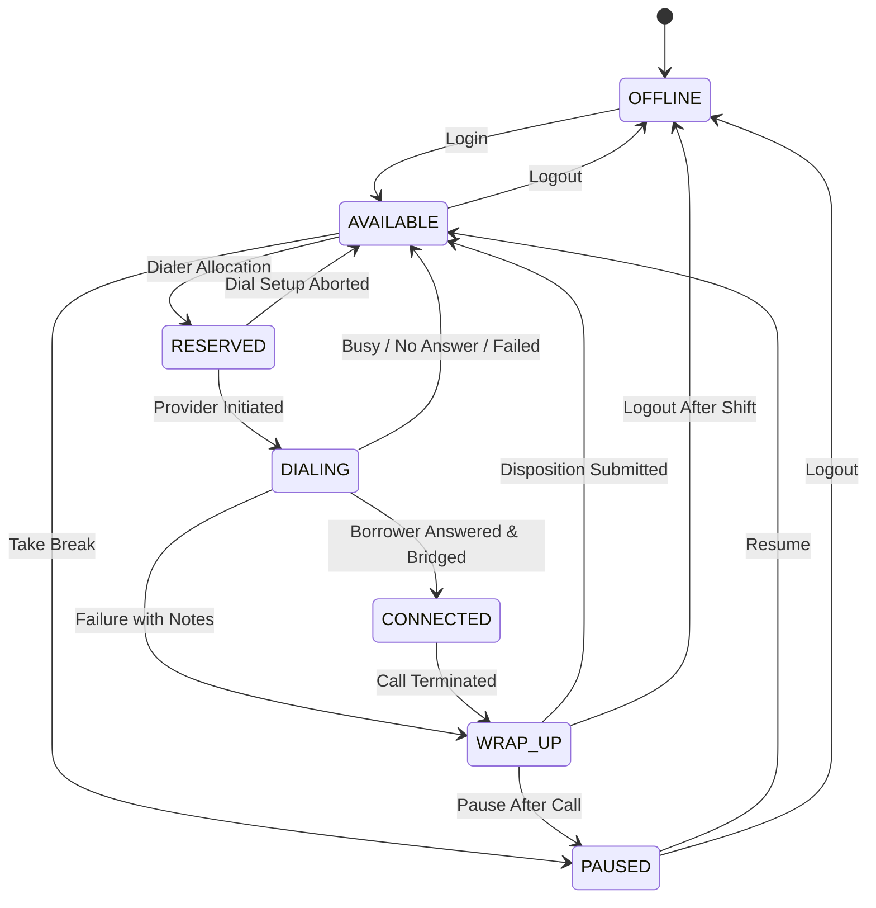
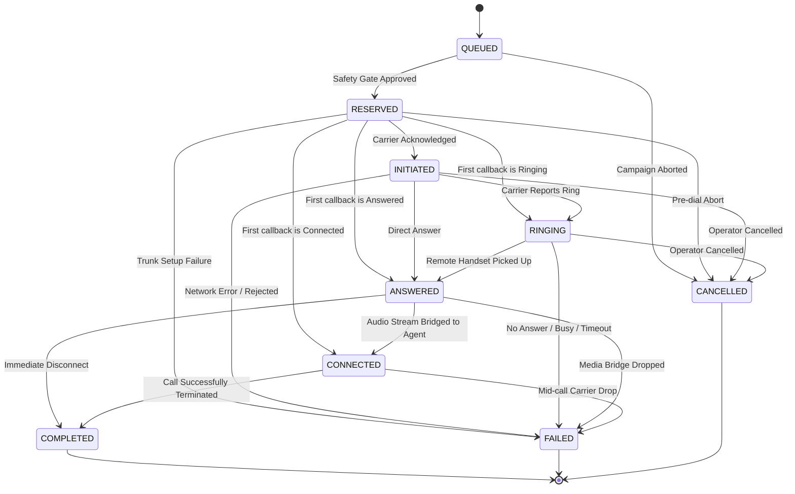

# State Machine Specifications: Agent & Call Lifecycles

This document formalizes the finite state machines governing the CredResolve SmartDialer prototype. Strict state validation prevents invalid lifecycle progression and guarantees data integrity.

---

## 1. Agent Lifecycle

The agent lifecycle models an outbound recovery specialist's availability and active engagement.


### Agent State Descriptions
| State | Description | Allocation Eligibility |
| :--- | :--- | :--- |
| `OFFLINE` | Agent not logged into dialer. | Ineligible |
| `AVAILABLE` | Agent idle, waiting for call assignment. | **Eligible** (Safe Headroom) |
| `RESERVED` | Agent atomically locked for an impending call attempt. | Ineligible |
| `DIALING` | Telecom provider is ringing remote handset for this agent. | Ineligible |
| `CONNECTED` | Call answered and bridged; agent talking to borrower. | Ineligible |
| `WRAP_UP` | Call finished; agent reviewing account & logging notes. | Ineligible |
| `PAUSED` | Agent temporarily on break, training, or personal time. | Ineligible |

### Legal Agent Transitions
- `OFFLINE` $\to$ `AVAILABLE`
- `AVAILABLE` $\to$ `RESERVED`, `PAUSED`, `OFFLINE`
- `PAUSED` $\to$ `AVAILABLE`, `OFFLINE`
- `RESERVED` $\to$ `DIALING`, `AVAILABLE` (if setup failed/cancelled)
- `DIALING` $\to$ `CONNECTED`, `AVAILABLE` (if no answer), `WRAP_UP`
- `CONNECTED` $\to$ `WRAP_UP`
- `WRAP_UP` $\to$ `AVAILABLE`, `PAUSED`, `OFFLINE`

---

## 2. Call Lifecycle

The call lifecycle models the progression of an outbound communication attempt from borrower queue to final disposition.


### Call State Descriptions
| State | Description | Category |
| :--- | :--- | :--- |
| `QUEUED` | Borrower selected for outbound dial, waiting in line. | Pending |
| `RESERVED` | Dialer paired borrower with an agent; safety verified. | Transient |
| `INITIATED` | SIP INVITE dispatched and acknowledged by telecom carrier. | In-Flight |
| `RINGING` | Telecom network 180 Ringing received from remote tower. | In-Flight |
| `ANSWERED` | Remote handset 200 OK received (human or voicemail). | In-Flight |
| `CONNECTED` | Bi-directional RTP audio bridged between borrower and agent. | Active |
| `COMPLETED` | Normal BYE termination; call completed successfully. | **Terminal** |
| `FAILED` | Call failed (busy, invalid number, carrier 5xx, timeout). | **Terminal** |
| `CANCELLED` | Call aborted before connection. | **Terminal** |

---

## 3. Critical Invariant: Terminal State Preservation

A core vulnerability in telecommunications event handling is out-of-order event delivery (e.g., from flaky Provider B or network retries).

### The "Late Answer" Threat
If a borrower disconnects immediately after ringing, Provider B might send:
1. `FAILED` (e.g., network dropout at $T=10s$)
2. Delayed `ANSWERED` (arriving out of order at $T=12s$)

### Defense Rule
In `CallStateMachine`:
- `COMPLETED`, `FAILED`, and `CANCELLED` are immutable terminal states.
- When an event targeting an already-terminal call arrives:
  1. The event processor checks `CallStateMachine.is_terminal(call.state)`.
  2. If true, the event is marked as processed in the idempotency log.
  3. The transition is rejected with `status: "rejected_illegal_transition"`.
  4. The call remains in its terminal state.
  5. The associated agent is NOT locked or altered.

## 4. Agent Availability During Provider Setup

An agent with a `current_call_id` for a non-terminal call cannot be manually
changed to another state through the agent-state API. The update returns HTTP
409 and leaves the reservation intact. `RESERVED` and `DIALING` therefore do
not permit an `OFFLINE` transition in the state machine. Provider setup runs
outside the allocation transaction; the state update is checked against the
same durable store lock and returns HTTP 409 while the reservation exists.

## 5. Restart State Reconciliation

Startup recovery reconciles call, agent, and borrower state in one SQLite
transaction:

| Persisted call/submission state | Recovery behavior |
|---|---|
| `RESERVED` / `NOT_SUBMITTED` | Mark `FAILED`, release agent, return borrower to `QUEUED`; never submit after restart. |
| `RESERVED` / `SUBMITTING` | Mark submission `UNKNOWN`, retain `RESERVED` assignment; never automatically retry uncertain acceptance. The prototype has no provider-status polling; operator/provider reconciliation is required. |
| `INITIATED`, `RINGING`, or `ANSWERED` / `ACCEPTED` | Retain call, set assigned agent to `DIALING`, keep borrower `DIALING`; `ANSWERED` still awaits bridge confirmation. |
| `CONNECTED` / `ACCEPTED` | Retain active call and synchronize assigned agent to `CONNECTED`. |
| Terminal call | Keep terminal state, release or move the associated agent to `WRAP_UP`, and reconcile borrower disposition. |

## 6. Provider Submission and Restart Recovery

Provider dispatch has a persisted status separate from the call lifecycle:

```text
NOT_SUBMITTED -> SUBMITTING -> ACCEPTED
                         \-> REJECTED
                         \-> UNKNOWN
```

- A reservation is committed before submission; `SUBMITTING` is committed
  before provider I/O.
- `REJECTED` is used only when the provider definitely did not accept the call.
  Such calls become terminal `FAILED` and release the agent and borrower.
- A timeout, task cancellation, or unexpected exception after submission is
  `UNKNOWN`, not proof of rejection. The call stays reserved and is not retried
  through the alternate provider.
- On startup, a dead owner's `NOT_SUBMITTED` reservation is failed and
  released. A dead owner's `SUBMITTING` reservation becomes `UNKNOWN` and
  remains assigned until manually reconciled with provider evidence; there is
  no automatic provider-status polling. Accepted
  initiated calls remain active and assigned.
- Event IDs and resulting call state are committed transactionally, so
  duplicate delivery remains idempotent after a process restart.
